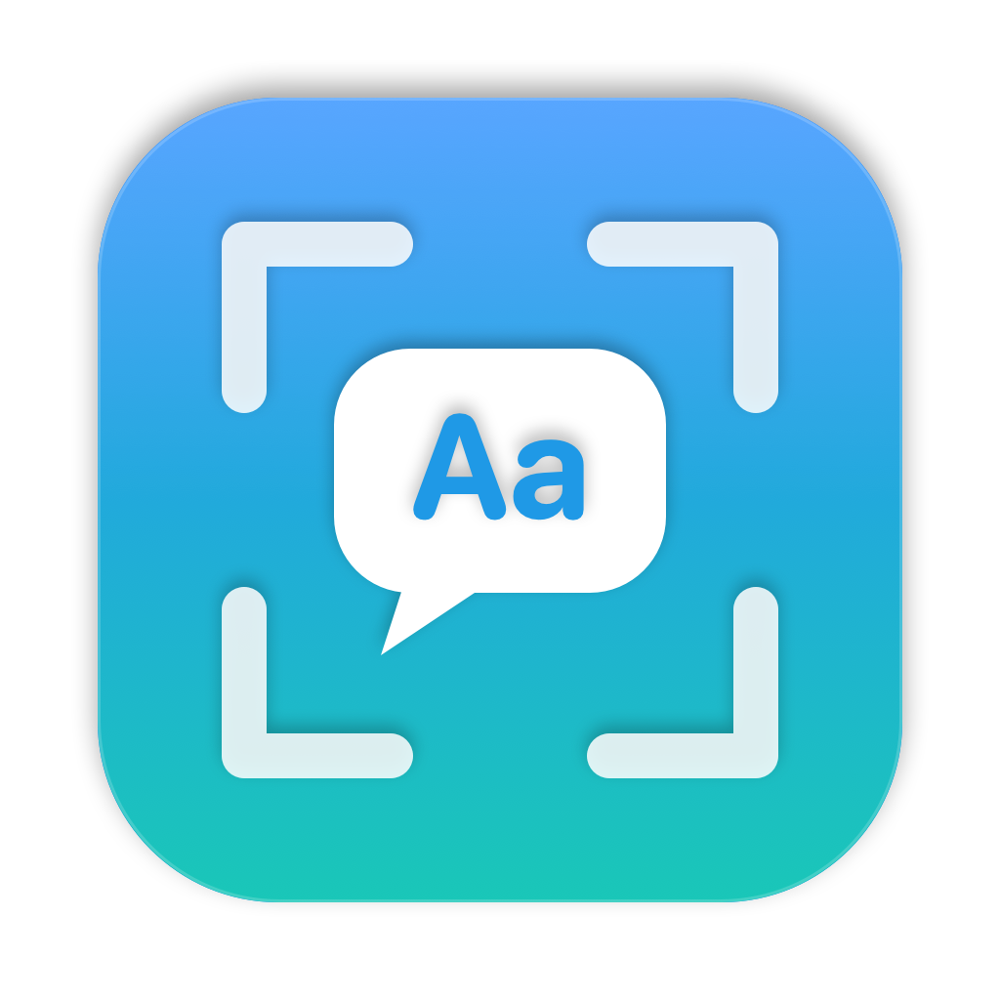
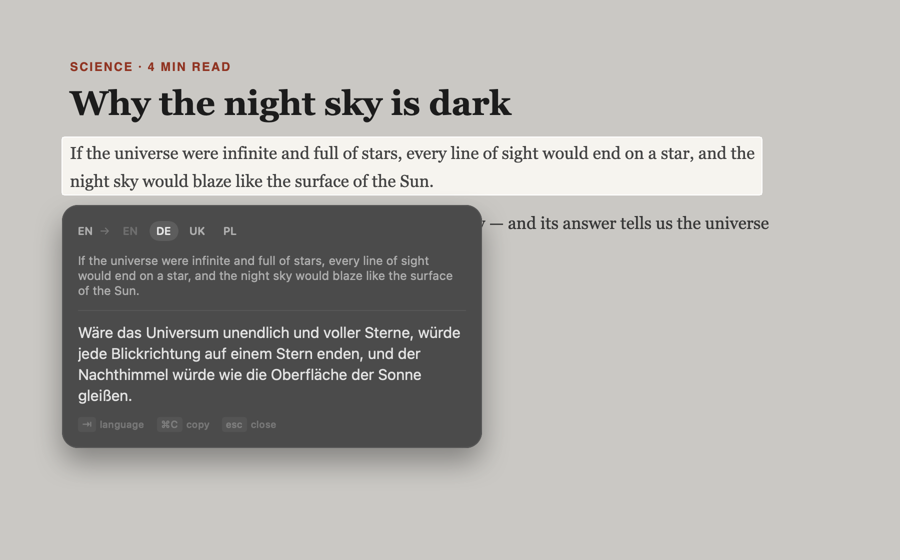

<p align="center">
  
</p>

<h1 align="center">Lens</h1>

<p align="center">
  Select any text on your Mac screen — read it in your language.<br>
  <sub>On-device · Free · Open source · macOS 15+</sub>
</p>

<p align="center">
  <a href="https://buhaenko.github.io/lens/">Website</a> ·
  <a href="https://github.com/buhaenko/lens/releases/latest">Download</a>
</p>

<p align="center">
  
</p>

## Install

```sh
curl -fsSL https://buhaenko.github.io/lens/install.sh | bash
```

That’s it — Lens lands in Applications and appears in the menu bar.
Prefer a DMG? Grab it from [Releases](https://github.com/buhaenko/lens/releases/latest).

## Use

| | |
|---|---|
| **Tap right ⌘** or press **⇧⌘7** | start a scan |
| **Drag** over any text | read & translate it |
| **Tab** / **⇧Tab** | next / previous language |
| **⌘C** · **⌥⌘C** | copy translation · copy original |
| **Esc** | close |

Works on anything you can see: videos, images, PDFs, games, other people’s screens.
Every scan is kept in a history in the menu bar — **search** it and **pin** the phrases worth keeping.
**Filters** keep it useful: skip languages you already read, numbers and codes, private info (emails, links, card numbers), short snippets or any words you choose.
**Updates** install themselves: once a day Lens checks the latest release, verifies its signature and restarts into the new version when you’re not using it. Turn it off in Settings, or use *Check for Updates…* in the right-click menu.
Languages, shortcuts and the popup are all customisable in Settings.

## Privacy

Text recognition ([Vision](https://developer.apple.com/documentation/vision)) and translation
([Translation](https://developer.apple.com/documentation/translation)) run on your Mac. Lens sends nothing anywhere —
no analytics, no accounts. The only download is a language pack, by macOS itself, the first time you translate into a new language.
Once a day Lens asks GitHub whether there's a new version; that request carries nothing about you or what you scanned (turn it off in Settings).

It asks for two permissions: **Screen Recording** to read the area you select, and **Accessibility** for the quick-scan key.

## Build from source

```sh
scripts/test.sh          # 130 unit + integration tests
scripts/build.sh 1.0.0   # → build/Lens.app, Lens.dmg, Lens.zip
```

Plain Swift, no dependencies, no Xcode project. Releases are built by
[GitHub Actions](.github/workflows/release.yml) from this repository.

## License

[MIT](LICENSE) © Serhii Buhaienko
